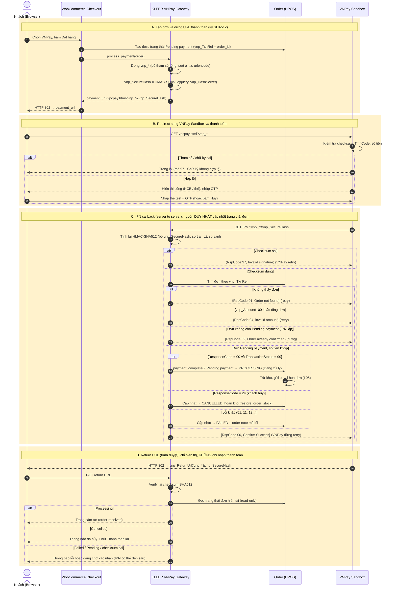

# L04-G2-01 — Sequence Diagram: Thanh toán trực tuyến qua VNPay Sandbox

- **Luồng:** L04 Checkout & Thanh toán · **Người thực hiện:** Trần Ngọc Minh Tuyền · **Người duyệt:** Lê Nguyễn Quốc An
- **File nguồn có thể chỉnh sửa:** [`L04_Checkout_VNPay_Sequence.drawio`](./L04_Checkout_VNPay_Sequence.drawio) (mở bằng draw.io / diagrams.net)
- **Nguồn kỹ thuật:** tài liệu VNPay Sandbox (`sandbox.vnpayment.vn/apis`), đã tổng hợp ở [`payment-gateway-research.md`](./payment-gateway-research.md). Vòng đời trạng thái đơn theo [`L05 flow-card`](../L05-order-processing/flow-card.md).
- **Phạm vi:** chỉ thiết kế, chưa có code tích hợp.

## 1. Các thành phần

| Ký hiệu | Thành phần | Vai trò |
|---|---|---|
| Khách | Browser của khách | Bấm đặt hàng, nhập thẻ/OTP tại VNPay |
| Checkout | WooCommerce Checkout | Tạo đơn, gọi `process_payment()` |
| Gateway | Plugin KLEER Payments (VNPay Gateway) | Dựng URL, ký/verify SHA512, xử lý IPN & Return |
| Order | Đơn hàng WooCommerce (HPOS) | Lưu trạng thái, trừ/hoàn kho |
| VNPay | VNPay Sandbox | Trang thanh toán, gọi IPN, redirect về ReturnUrl |

## 2. Sơ đồ

## 3. Mô tả luồng tuần tự

### A. Tạo đơn và URL thanh toán (bước 1–7)
1. Khách chọn VNPay và bấm Đặt hàng; WooCommerce tạo đơn **Pending payment** (L05, trạng thái 1). `vnp_TxnRef` lấy từ order ID (duy nhất, VNPay yêu cầu không trùng trong ngày).
2. Gateway dựng tham số `vnp_Version=2.1.0`, `vnp_Command=pay`, `vnp_TmnCode`, `vnp_Amount` (**VND × 100**), `vnp_CreateDate` (`yyyyMMddHHmmss`, GMT+7), `vnp_CurrCode=VND`, `vnp_IpAddr`, `vnp_Locale`, `vnp_OrderInfo` (không dấu), `vnp_OrderType`, `vnp_ReturnUrl`, `vnp_TxnRef`, tùy chọn `vnp_ExpireDate`.
3. **Ký:** bỏ tham số rỗng → sort key a→z → nối `urlencode(key)=urlencode(value)` bằng `&` → `vnp_SecureHash = HMAC-SHA512(chuỗi, vnp_HashSecret)`. Gắn vào URL và redirect (HTTP 302) khách sang `https://sandbox.vnpayment.vn/paymentv2/vpcpay.html`.

### B. Thanh toán tại VNPay (bước 8–11)
4. VNPay kiểm tra checksum/tham số; sai → trang lỗi (mã `97`). Đúng → khách chọn ngân hàng/thẻ, nhập OTP (hoặc bấm Hủy). Thẻ test: xem `payment-gateway-research.md` mục 1.

### C. IPN: cập nhật trạng thái đơn (bước 12–16)
5. VNPay gọi **IPN URL** (server → server). Gateway **tính lại HMAC-SHA512** trên các `vnp_*` nhận được (trừ `vnp_SecureHash`) và so với `vnp_SecureHash`. Sai → trả `RspCode 97`.
6. Theo thứ tự kiểm tra của VNPay: tìm đơn (`01`) → khớp số tiền (`04`) → đơn còn Pending payment, chống xử lý lặp (`02`) → cập nhật:
   - `vnp_ResponseCode=00` **và** `vnp_TransactionStatus=00` → `payment_complete()` → **Processing (Đang xử lý)**; kích hoạt trừ kho + email hóa đơn theo L05.
   - `24` (khách hủy) → **Cancelled**, hoàn kho.
   - Mã lỗi khác → **Failed**, lưu mã lỗi vào order note.
7. Trả JSON `{"RspCode":"00","Message":"Confirm Success"}`. VNPay dừng retry khi nhận `00`/`02`; nhận `01/04/97/99` hoặc timeout thì gọi lại.

### D. Return URL (bước 17–20)
8. Trình duyệt được redirect về `vnp_ReturnUrl`. Gateway verify lại checksum, **chỉ đọc** trạng thái đơn và hiển thị kết quả. Không cập nhật đơn ở đây: nếu khách đóng tab trước khi quay về, đơn vẫn được cập nhật qua IPN. Nếu IPN chưa tới kịp, hiển thị "đang chờ xác nhận".

## 4. Đối chiếu DoD

| Yêu cầu DoD | Thể hiện trong sơ đồ |
|---|---|
| Kiểm tra mã băm checksum SHA512 | Bước ký (A), kiểm tra ở VNPay, verify ở IPN (C) và Return (D) |
| Cập nhật trạng thái đơn "Đang xử lý" | Nhánh `ResponseCode=00 & TransactionStatus=00` → Processing |
| Xử lý hủy giao dịch | Nhánh `ResponseCode=24` → Cancelled + hoàn kho; Return URL hiển thị nút thanh toán lại |
| Tạo URL, redirect, nhận IPN | Nhóm A, B, C |

## 5. Quyết định thiết kế cần Scrum Master / L05 xác nhận
- **Mã 24 → `Cancelled`, lỗi khác → `Failed`:** là đề xuất của tôi, vì L05 chỉ định nghĩa `Cancelled` cho "khách hủy hoặc quá hạn". VNPay không quy định trạng thái phía WooCommerce.
- **Thanh toán lại:** đơn `Cancelled` hoặc `Failed` thì tạo URL mới (đơn mới hoặc `vnp_TxnRef` mới) vì `vnp_TxnRef` không nên dùng lại.
- **Hết hạn (mã 11):** hiện gộp vào nhánh "lỗi khác → Failed"; có thể đổi sang Cancelled cho khớp L05.
- Bộ mã `RspCode` IPN (00/01/02/04/97/99) và quy tắc retry lấy từ trang chính thức `sandbox.vnpayment.vn/apis/docs/chuyen-doi-thuat-toan/`. Danh sách mã `vnp_ResponseCode` lấy từ `.../bang-ma-loi/`.
- IPN cần URL công khai khi dev ở localhost (ngrok / cloudflared).
